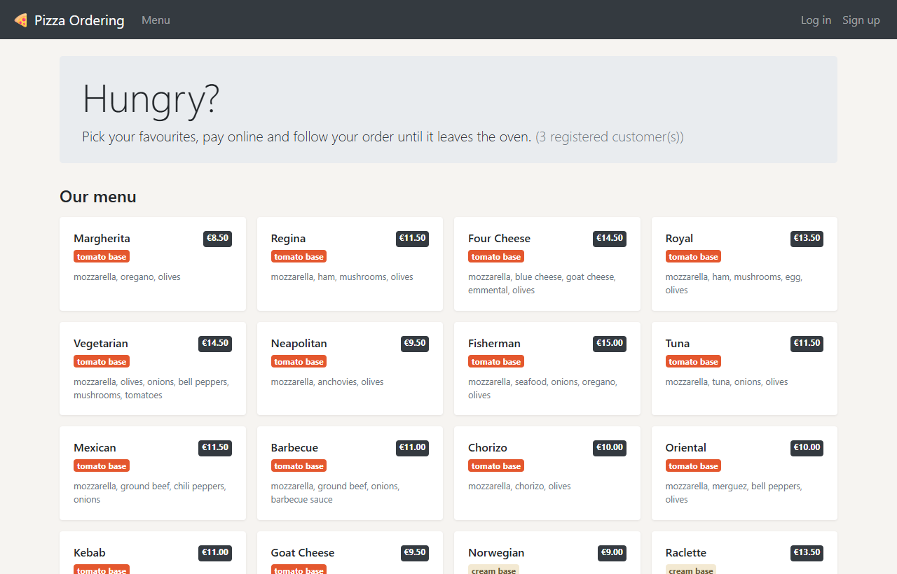
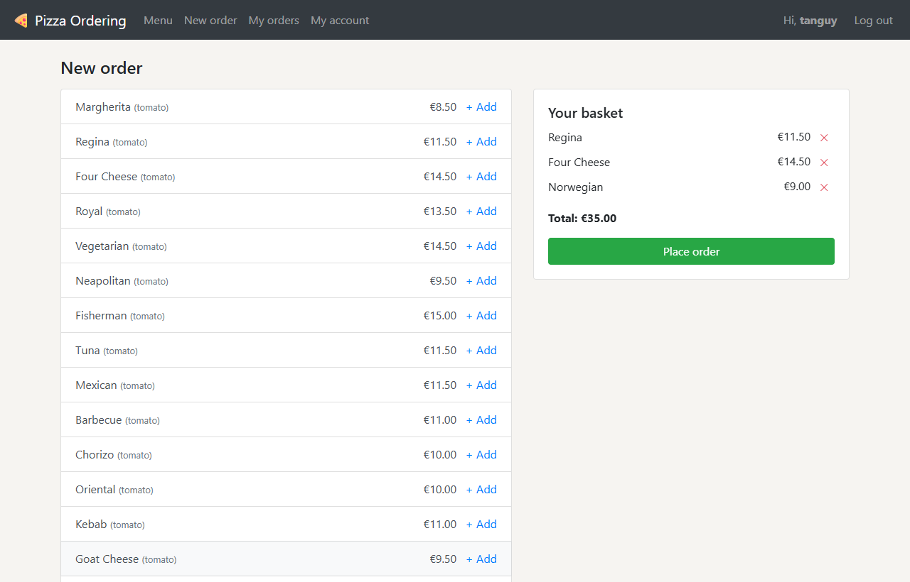
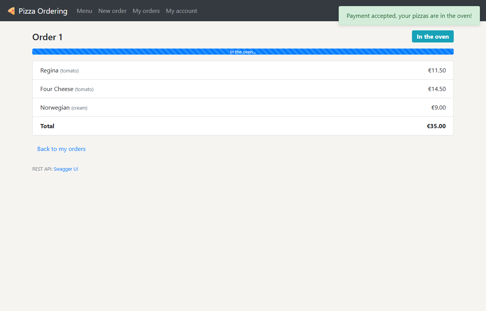
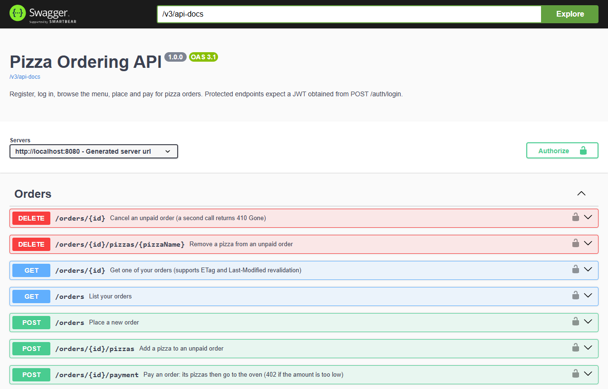
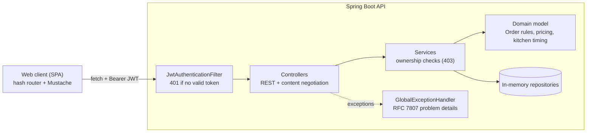

# 🍕 Pizza Ordering Platform

A full-stack pizza ordering app: a **Spring Boot REST API** secured with **JWT**, and a lightweight **single-page client** in vanilla JavaScript.
Customers sign up, browse the menu, build an order, pay, and follow their pizzas in real time until they leave the oven.

   

<p align="center">
  
  
  
  
</p>

---

## ✨ Highlights

| | |
|---|---|
| **Clean layered architecture** | Controllers → services → repositories, with business rules in the domain model and no `try/catch` in controllers (centralised error handling). |
| **Stateless security** | JWT authentication, BCrypt-hashed passwords, token revocation on logout, ownership checks (`401` vs `403`). |
| **HTTP done right** | Meaningful status codes (`201` + `Location`, `204`, `402`, `409`, `410`…), [RFC 7807](https://www.rfc-editor.org/rfc/rfc7807) error bodies, JSON **and** XML content negotiation. |
| **HTTP caching** | Conditional requests with `ETag` / `If-None-Match` and `Last-Modified` / `If-Modified-Since` → `304 Not Modified`. Order ETags are version-based, so changes made within the same second are never served stale. |
| **Tested** | 28 automated tests: unit tests of the domain (with an injectable `Clock`) and end-to-end MockMvc tests of the API. CI on GitHub Actions. |
| **Documented** | Interactive OpenAPI documentation (Swagger UI). |
| **Framework-free front end** | Hash-based router, Mustache templates, `fetch` API, live order tracking by polling. |

## 🚀 Run it in one command

Only **Java 21** is required (Maven is downloaded by the wrapper).

```bash
cd api
./mvnw spring-boot:run        # Windows: mvnw.cmd spring-boot:run
```

Then open:
- **Web app** → http://localhost:8080
- **API docs (Swagger UI)** → http://localhost:8080/swagger-ui.html

<details>
<summary>With Docker</summary>

```bash
docker build -t pizza-ordering .
docker run -p 8080:8080 pizza-ordering
```
</details>

## 🧱 Tech stack

| Layer | Technologies |
|---|---|
| Back end | Java 21, Spring Boot 3.5 (Web MVC, Validation), JJWT, Spring Security Crypto (BCrypt), Jackson (JSON + XML), springdoc-openapi |
| Front end | HTML, CSS (Bootstrap 4), vanilla JavaScript (ES2020), Mustache.js |
| Quality | JUnit 5, AssertJ, Spring MockMvc, GitHub Actions |
| Delivery | Maven wrapper, executable jar, Docker multi-stage build |

## 🗺️ Architecture



**Order lifecycle:** `AWAITING_PAYMENT` (editable) → *payment* → `PREPARING` (pizzas in the oven) → `READY`.
Business rules live in [`Order`](api/src/main/java/com/pizzaplatform/api/model/Order.java): a paid order is locked, an empty order cannot be paid, and the payment must cover the price.

## 📡 API overview

| Method | Endpoint | Auth | Description |
|---|---|:---:|---|
| `GET` | `/menu` | – | Pizzas on the menu (cacheable 1 h) |
| `POST` | `/customers` | – | Sign up → `201 Created` |
| `GET` | `/customers` | – | Links to all customers |
| `POST` | `/auth/login` | – | Get a JWT |
| `POST` | `/auth/logout` | ✅ | Revoke the token |
| `GET` `PUT` `DELETE` | `/customers/{login}` | ✅ owner | Profile (`ETag` support), rename, delete account |
| `GET` `POST` | `/orders` | ✅ | List my orders / place an order |
| `GET` `PUT` `DELETE` | `/orders/{id}` | ✅ owner | Get (`ETag` + `Last-Modified` support), replace pizzas, cancel (`410 Gone` afterwards) |
| `POST` | `/orders/{id}/pizzas` | ✅ owner | Add a pizza |
| `DELETE` | `/orders/{id}/pizzas/{name}` | ✅ owner | Remove a pizza |
| `POST` | `/orders/{id}/payment` | ✅ owner | Pay (`402` if the amount is too low) |

<details>
<summary>Try it with curl</summary>

```bash
curl -X POST localhost:8080/customers -H "Content-Type: application/json" \
     -d '{"login":"alice","name":"Alice","password":"secret123"}'

TOKEN=$(curl -s -X POST localhost:8080/auth/login -H "Content-Type: application/json" \
     -d '{"login":"alice","password":"secret123"}' | sed 's/.*"token":"\([^"]*\)".*/\1/')

curl -X POST localhost:8080/orders -H "Authorization: Bearer $TOKEN" \
     -H "Content-Type: application/json" -d '{"pizzas":["Margherita","Regina"]}'

curl localhost:8080/orders/1 -H "Authorization: Bearer $TOKEN" -H "Accept: application/xml"
```
</details>

## ✅ Tests

```bash
cd api
./mvnw verify
```

- [`OrderTest`](api/src/test/java/com/pizzaplatform/api/model/OrderTest.java): pricing, payment rules, status transitions and caching dates, with a controllable clock.
- [`MenuServiceTest`](api/src/test/java/com/pizzaplatform/api/service/MenuServiceTest.java): CSV loading and validation.
- [`ApiIntegrationTest`](api/src/test/java/com/pizzaplatform/api/controller/ApiIntegrationTest.java): full HTTP scenarios (authentication, `403`/`410`/`402`/`409`, `304` revalidation, XML), including a regression test for same-second cache invalidation.

## 📁 Project structure

```
├── api/                         Spring Boot application
│   └── src/main/java/com/pizzaplatform/api/
│       ├── controller/          REST endpoints
│       ├── service/             Business logic & authorization
│       ├── model/               Domain (Order, Pizza, Customer…)
│       ├── repository/          Thread-safe in-memory storage
│       ├── security/            JWT issuing, validation, filter
│       ├── exception/           Business exceptions + RFC 7807 handler
│       ├── dto/                 Request/response payloads (JSON & XML)
│       └── config/              CORS, OpenAPI, typed properties
└── client/                      Single-page web app (bundled into the jar at build time)
```

## 🔭 Possible next steps

- Replace the in-memory repositories with Spring Data JPA + PostgreSQL (the services would not change).
- Migrate the custom filter to Spring Security for role-based access (e.g. a kitchen staff role).
- Push order status updates with Server-Sent Events instead of polling.

## 🎓 Context

Started as a team project for the *Web Application Development* course (M1, Université Claude Bernard Lyon 1), built with Alexandre Delort on top of a starter kit provided by the teaching staff. It was then reworked and translated into English for this portfolio.
